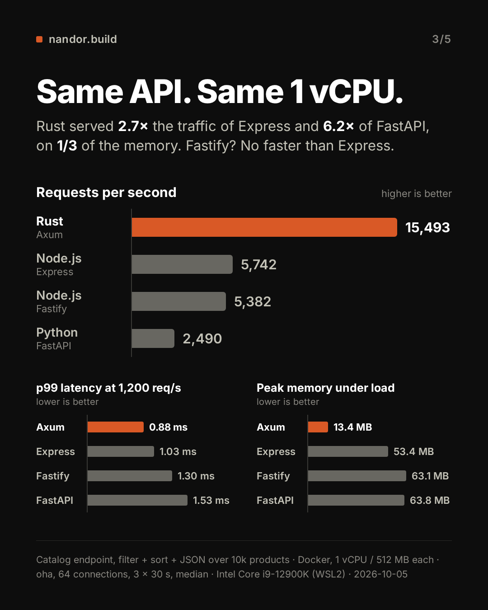

# Rewrite it in Rust: hype or worth it?

The same catalog API in **Rust (Axum)**, **Node.js (Fastify)**, **Node.js (Express)** and **Python (FastAPI)**,
each pinned to 1 vCPU and 512 MB in Docker, measured with [oha](https://github.com/hatoo/oha) —
then priced, because req/s only matters next to a bill.



## Results

Catalog endpoint, filter + sort + JSON over 10k products. 3 x 30 s per stack, median reported.
p50 and p99 are measured in a separate pass at a fixed **1,200 req/s** for every stack,
so the latency numbers compare like with like instead of each stack being measured at its own breaking point.

| Stack | Version | req/s (median) | p50 (ms) | p99 (ms) | Peak mem (MB) | Idle mem (MB) | CPU % |
|---|---|---:|---:|---:|---:|---:|---:|
| **Rust / Axum** | rustc 1.99.0, axum 0.8.9 | 15,493 | 0.29 | 0.88 | 13.4 | 6.1 | 99.4 |
| **Node.js / Fastify** | Node.js 24.21.0, Fastify 5.12.5 | 5,382 | 0.35 | 1.3 | 63.1 | 30 | 99.5 |
| **Node.js / Express** | Node.js 24.21.0, Express 5.2.1 | 5,742 | 0.33 | 1.03 | 53.4 | 25.4 | 99.6 |
| **Python / FastAPI** | Python 3.13.16, FastAPI 0.142.2, Pydantic 2.13.5, uvicorn 0.54.0 | 2,490 | 0.54 | 1.53 | 63.8 | 59.9 | 99.6 |

- Rust served **2.7x** the requests of Express and **6.2x** of FastAPI on the same single core.
- Fastify came out **0.9x** Express here, i.e. no faster. Same runtime, same ceiling, and on this
  payload Fastify's schema serialiser costs more than it saves. There is a section on that below.
- Rust held peak memory at **1/3** of the lightest other stack's (13.4 MB vs Express's 53.4 MB).
  These three columns come from a `docker stats` stream that is not committed, unlike the throughput and
  latency numbers; re-run `make bench` to reproduce them.

Per-run numbers, so you can see the spread rather than trusting a single median:

| Stack | req/s runs | p50 ms runs | p99 ms runs |
|---|---|---|---|
| Axum | 15449.2 / 15493.4 / 15512.5 | 0.29 / 0.28 / 0.29 | 0.88 / 0.87 / 0.9 |
| Fastify | 5382 / 5390.1 / 5379.6 | 0.33 / 0.35 / 0.35 | 1.25 / 1.3 / 1.3 |
| Express | 5751 / 5742.4 / 5711.4 | 0.33 / 0.33 / 0.34 | 1.03 / 1.03 / 1.05 |
| FastAPI | 2490 / 2471.4 / 2490.8 | 0.54 / 0.54 / 0.55 | 1.53 / 1.52 / 1.57 |

Every raw oha run is committed under [`results/raw/`](results/raw), and the full machine-readable
result is [`results/results.json`](results/results.json).

**One measurement was rejected and repeated.** Fastify exceeded the 5% spread gate on the first attempt, so the runner threw that attempt away and measured the stack again on a fresh container. The rejected runs are committed too, as `results/raw/*-rejected*.json`, so you can check which way the discard went rather than taking it on trust.

### Why Fastify came out below Express here

Published benchmarks usually put Fastify well ahead of Express, so this result needs an explanation
rather than a shrug.

Fastify's one structural advantage in this test is its documented fast path: declaring the 200 response
schema so [fast-json-stringify](https://github.com/fastify/fast-json-stringify) replaces
`JSON.stringify`. That pays off on small, flat payloads. This endpoint returns **50 full product objects,
about 8 KB with 8 fields each**, and at that size it stops paying off — V8's native `JSON.stringify` is
optimised C++, while fast-json-stringify is generated JavaScript.

Two side experiments, run on the same machine. They are **not** part of the benchmark and are not in
`results.json`; the scripts and the raw oha output are committed under
[`experiments/fastify-schema/`](experiments/fastify-schema) so the numbers below can be checked rather than
taken on trust.

- **Serialising one of the pages the load pattern generates** (`books`, 100-800, `price_asc`) in isolation,
  compiling the exact schema the server declares: `JSON.stringify` 13.1 us/op vs fast-json-stringify 7.0.1 at
  17.5 us/op — the schema serialiser is **0.75x native** (captured in
  [`raw/serialiser.txt`](experiments/fastify-schema/raw/serialiser.txt); repeated runs land between 0.75x and
  0.80x). This is a ratio between two functions in one process, not a throughput number, and it was not
  CPU-pinned.
- **The same Fastify server with the `response` schema removed**, 3 x 30 s at
  `-c 64` on the same 1 vCPU pin: **6,292 req/s** (runs: 6,313 / 6,270 / 6,292, spread
  0.69%, every run 100% HTTP 200, byte-identical response body). That puts Fastify ahead of Express by
  **1.09x** — a far smaller margin than published framework benchmarks suggest — and means the schema costs it
  ~15% here. Unlike the main table this run had no warmup, no `docker stats` bottleneck check and no spread
  gate; it is a side experiment, not a measurement to the same standard.

So Fastify is not misconfigured here, and it is not being handicapped on purpose: it is running the setup its own
documentation recommends, and on this payload that setup costs it more than it pays. The benchmark keeps the
schema, because removing it to make a stack look better is exactly the kind of tuning this repo refuses to do.
To reproduce, [`experiments/fastify-schema/derive-noschema.mjs`](experiments/fastify-schema/derive-noschema.mjs)
regenerates the variant from the current [`servers/node-fastify/server.js`](servers/node-fastify/server.js) by
deleting only the `response` block, so it cannot drift from the server that is actually measured.

### What FastAPI's declared return type does

Fastify's documented fast path cost it performance here, so the symmetric question is what FastAPI's costs.
`/products` declares `-> ProductsPage` and leaves the response class at its default, which is what selects
FastAPI's `dump_json` path: the returned object is checked against the route's response model — an identity
check rather than a re-validation, because the handler returns the `Product` instances it already holds — and
then Pydantic's Rust core writes the response body as bytes in a single pass, with no intermediate Python dict
and no `json.dumps`. So unlike Fastify, here the idiomatic choice is also the cheap one and there is nothing to
trade off. That path exists from FastAPI 0.130 onwards; earlier versions take a slower dict-then-`json.dumps`
route for the same source code, which is one reason
[`requirements.txt`](servers/python-fastapi/requirements.txt) pins the version. No FastAPI variant was
benchmarked, so unlike the Fastify section this one claims no number.

The wider lesson is the same one the cost model makes: **ratios from someone else's benchmark do not
transfer to your workload.** This endpoint is compute-heavy, which compresses every framework gap —
it is also why Rust comes out at 2.7x here rather than the 3-4x a hello-world test would show,
and why FastAPI looks relatively better than its reputation.

## Machine

| | |
|---|---|
| CPU | Intel Core i9-12900K (WSL2) |
| Logical CPUs | 24 (24 visible to Docker) |
| RAM | 23 GB |
| OS | Ubuntu 22.04.3 LTS (WSL2) |
| Docker | 26.1.3 |
| Load generator | oha 1.16.0 |
| Date | 2026-10-05 |

## Methodology

**Dataset.** 10,000 products generated by [`data/generate.mjs`](data/generate.mjs) with a seeded
PRNG (mulberry32, seed 42) and committed, so every stack and every re-run loads byte-identical data:
10 categories of 1,000 products each, prices 1.00–999.99, ratings 1.0–5.0, ~10% out of stock, 0–3 tags,
and `created_at` as a plain ISO 8601 string — never parsed into a date type, because that would reformat
it on the way out and break JSON parity. Each server builds a per-category index at startup; startup is not measured.

**Endpoint.** `GET /products?category=&min_price=&max_price=&sort=&limit=`, identical in all four stacks:
take the category's products, keep those with `min_price <= price <= max_price` **and** `stock > 0`, count them
into `total`, sort by `price_asc` / `price_desc` / `rating_desc` with ties **always** broken by `id` ascending,
take the first `limit` (1–100, default 20), return `{"total": int, "items": [...]}`.
Invalid parameters return 400 everywhere — including FastAPI, which needs a `RequestValidationError` handler
to stop answering 422.

**No cheating, in any stack.** No response caching, no per-query memoisation, no pre-sorted copies per sort key,
no pre-serialised JSON, no compression, no request logging, no ETags. Every request does the full filter,
sort and serialise. Each stack does get its own idiomatic production setup and nothing more: Fastify declares
its 200 response schema (fast-json-stringify), Express gets `etag: false` and `x-powered-by` disabled so it is
not penalised for headers nobody else sends, FastAPI holds Pydantic instances and declares `ProductsPage` as the
return type, and Rust is a plain `cargo build --release` with the default profile — no LTO tweaks, no custom
allocator, no unsafe.

**Docker pinning.** One server at a time, `--cpuset-cpus=1 --cpus=1 --memory=512m`, a fresh container per stack.
The load generator runs in its own container pinned to CPUs 2-23, never on the server's CPU, and reaches the
server **by container name on the `bench-net` Docker network** — no host port-forward is ever in the measurement
path, because on Docker Desktop that proxy becomes the bottleneck before the server does. CPU 0 is left to the
OS and dockerd.

**Load.** Every stack gets the same request mix, generated by oha from one regex:

```
http://<server>:8080/products\?category=(electronics|books|home|toys|sports|beauty|garden|grocery|fashion|automotive)&min_price=[1-3]00&max_price=[6-9]00&sort=(price_asc|price_desc|rating_desc)&limit=50
```

**Runs.** 10 s of identical warmup load first, discarded (the Node stacks need the JIT warm).
Then pass 1: `oha -z 30s -c 64 --wait-ongoing-requests-after-deadline`, 3 runs, median `requestsPerSec`.
Then pass 2, after pass 1 finished for all four stacks: a fixed rate of
`1,200` req/s — `max(100, floor(0.5 x min(median rps) / 100) x 100)` — with
`--latency-correction`, 3 runs, median p50 and p99. Every run had to come back 100% HTTP 200 or the
benchmark aborts. Memory and CPU come from `docker stats` streamed during pass 1.

**Parity gate.** [`bench/parity.mjs`](bench/parity.mjs) runs before any measurement — `make bench` will not
start without it. 32 URLs ([`bench/urls.txt`](bench/urls.txt)) covering every category, every sort,
limits 1/20/50/100, an empty result, an unknown and an empty category, and boundary prices exactly equal to a real
product's price — fetched from all four servers, `JSON.parse`d and deep-compared against the Rust response, plus
12 invalid requests that must be 400 everywhere. Any mismatch aborts the run. A benchmark of four servers that
disagree measures nothing.

The comparison is on parsed JSON, not bytes: serialisers legitimately differ on number formatting (serde writes
`5.0` where V8 writes `5`) and on key order. What is verified is that every request the benchmark sends, and
every invalid form the gate checks, produces the same status and the same JSON value in all four stacks. Error
*bodies* are not compared. Beyond that surface each stack uses its own language's string-to-number parser, and
they disagree on exotic literals — `limit=50.0`, `1e2`, `0x10`, leading or trailing whitespace, Python's
`1_0`, and duplicate query keys. Normalising those would mean replacing each framework's native query parsing,
which is part of what is being measured, so they are documented here rather than papered over. The load generator
never sends them.

**Sanity checks that can fail the run**, not just decorate it: the Rust server must log
`available_parallelism=1` under the pin (otherwise tokio sized its pool for the whole host);
every stack must reach 90%+ median CPU during pass 1 (otherwise the server was not the bottleneck and
the numbers are void); and `oha --dump-urls` output must match the intended URL shape.

## Reproduce

```bash
make all        # data, build, parity, bench, render
```

Needs Docker with at least 4 CPUs visible (`docker info --format '{{.NCPU}}'`) and Node.js for the runner
and the renderer. Individual steps: `make data`, `make build`, `make parity`, `make bench`, `make render`,
`make clean`.

**On Docker Desktop (macOS/Windows), give the VM at least 6 CPUs and 8 GB** before running, or the load
generator and the server will fight over the same cores and every number will be wrong.
Close heavy apps and keep the laptop on power.

## Caveats

- **This endpoint is CPU-bound on purpose** — in-memory filter, sort and JSON, no I/O. That is exactly where a
  compiled language wins. If your API spends most of its time waiting on a database, the latency gains shrink
  toward nothing, and the compute savings scale with CPU time per request, not with the ratios here.
- **1 vCPU per server, so this measures per-core efficiency**, not maximum capacity. Every one of these stacks
  scales out with more processes; Node and Python need more of them to fill a box, which is the whole point of
  the cost model below.
- **It is a synthetic benchmark on one machine.** One desktop: 12th Gen Intel Core i9-12900K, Docker inside a WSL2 VM,
  which presents its own flat 12-core/24-thread topology. The real chip is 8 P-cores plus 8 E-cores,
  and from inside the VM there is no way to tell which physical core a pinned vCPU is running on, or whether it
  stays there. Same conditions for all four stacks, but not a clean-room result. Your numbers will differ. Run it.
- **Latency is measured at a fixed 1,200 req/s**, which is half the slowest stack's
  throughput. At its own saturation point every stack looks much worse; comparing p99 at each stack's own
  maximum would be comparing different experiments.

## The cost model

Throughput is not an argument. A bill is. Baseline is Node.js (Express):

```
speedup        = rps(axum) / rps(express)          = 2.70
rust_bill      = monthly_bill / speedup
savings        = monthly_bill - rust_bill
payback_months = $20k rewrite / savings
```

| Company | App servers today | On Rust | Saves | $20k rewrite pays back | At half the savings | Verdict |
|---|---|---|---|---|---|---|
| Company A | $2,500/mo | $930/mo | $1,570/mo | ~13 months | ~2.1 years | **Not yet** |
| Company B | $20,000/mo | $7,410/mo | $12,590/mo | ~7 weeks | ~3 months | **Start yesterday** |

Same benchmark, opposite answers. That is the entire point: the speedup is a constant, the payback is not.

Only **app-server compute** shrinks. Database, storage and egress do not. And the usual cheap escape hatch did not
show up here either: swapping Express for Fastify measured 0.9x, so on this workload the choice is
the runtime, not the framework.

All of it is in [`render/config.json`](render/config.json) — change the bills and re-run `make render`.

## Further reading

- Grab, Counter Service rewrite: https://engineering.grab.com/counter-service-how-we-rewrote-it-in-rust
- Cloudflare, Pingora: https://blog.cloudflare.com/how-we-built-pingora-the-proxy-that-connects-cloudflare-to-the-internet/
- Microsoft, TypeScript native port (Go): https://devblogs.microsoft.com/typescript/typescript-native-port/
- Sharkbench: https://sharkbench.dev/web

---

Built by Nandor, [nandor.build](https://nandor.build). I help startups find out whether a rewrite pays back,
then do it at a fixed price.

## License

MIT — see [LICENSE](LICENSE).
